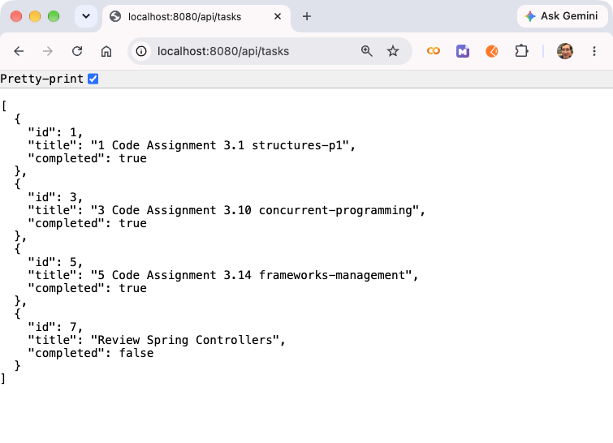
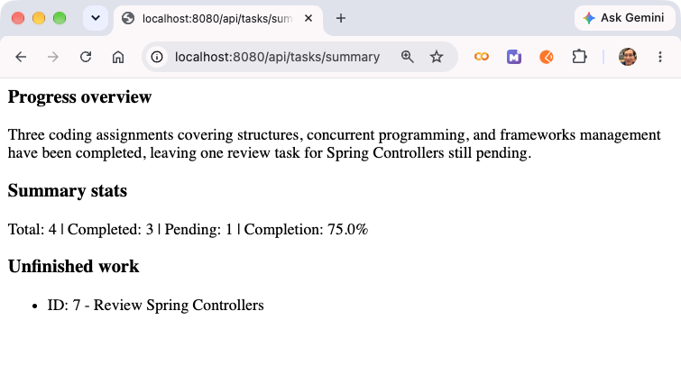
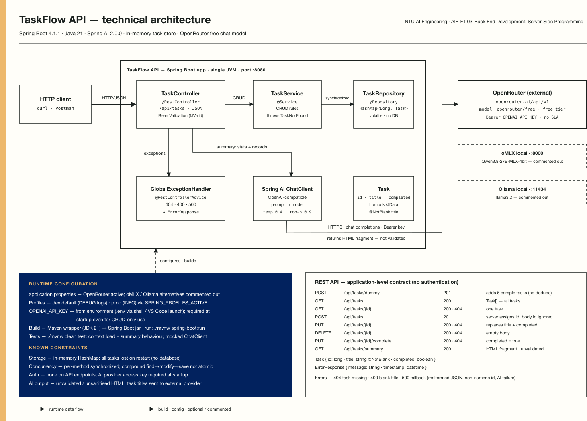
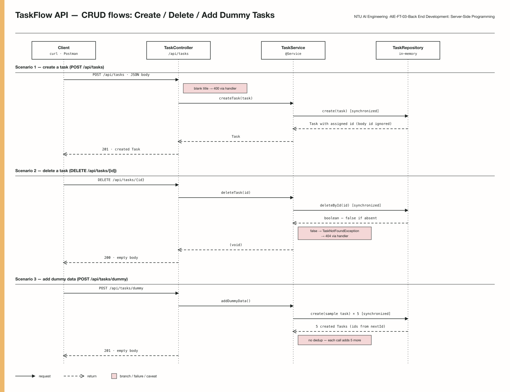

# TaskFlow API

TaskFlow is a simple task management API built for the NTU AI Engineering Module 3 assignment. It lets you create, view, update, delete, and complete tasks. It also includes a Spring AI endpoint that summarises completed and pending work.

Tasks are stored in memory and are cleared when the application restarts.

## Current limitations

- Storage is temporary. The repository is implemented in memory using a `HashMap`.
- **Not Thread Safe**: The in-memory repository does not make a complete update operation atomic across concurrent requests. 
- Missing tasks return `404`, and blank titles return `400`. The general exception handler currently returns `500` for some other client errors, including malformed JSON and invalid IDs.
- AI output can be inaccurate. Generated HTML is not validated or sanitised by the application.


## Technology

- Java 21
- Spring Boot 4.1.1 and Spring MVC
- Maven Wrapper
- Lombok and Jakarta Bean Validation
- Spring AI 2.0.0 with an OpenAI-compatible provider

## Project structure

The Maven application is inside `taskflow-api/`. Its Java classes use the base package `sg.edu.ntu.taskflow_api`.

| Package | Purpose |
| --- | --- |
| `controller` | Handles HTTP requests and responses. |
| `service` | Implements task operations. |
| `repository` | Stores tasks in a HashMap and assigns IDs. |
| `model` | Defines the task data. |
| `exception` | Defines errors and handles exceptions. |

## Run locally

Install JDK 21 and check that `java -version` reports Java 21. The Maven Wrapper is included, so a separate Maven installation is not needed. The first build needs internet access to download dependencies.

From the repository root, enter the application folder:

```bash
cd taskflow-api
```

Set your provider API key in the terminal:

```bash
export OPENAI_API_KEY="your-provider-api-key"
```

The current configuration uses OpenRouter at `https://openrouter.ai/api/v1` with the `openrouter/free` chat model. Use an OpenRouter key for this configuration. Alternative local model settings are commented in `src/main/resources/application.properties`.

The application requires a key setting at startup, even when you only use the CRUD endpoints. Keep real keys outside the repository. A `.env.example` file is included as a reference, but a `.env` file must be loaded explicitly.

Start the application:

```bash
./mvnw spring-boot:run
```

The API is available at `http://localhost:8080/api/tasks`. On Windows, use `mvnw.cmd` in place of `./mvnw` and set the environment variable using your shell.

The `dev` profile is active by default. To select the `prod` logging profile, set `SPRING_PROFILES_ACTIVE=prod` before starting the application.

## Endpoints

| Method | Path | Action | Success status |
| --- | --- | --- | --- |
| POST | `/api/tasks/dummy` | **Adds five sample tasks for demo/testing**. Each call adds another five. | 201 |
| GET | `/api/tasks` | List all tasks. | 200 |
| GET | `/api/tasks/{id}` | Get one task. | 200 |
| POST | `/api/tasks` | Create a task. | 201 |
| PUT | `/api/tasks/{id}` | Replace a task's title and completion status. | 200 |
| DELETE | `/api/tasks/{id}` | Delete a task. | 200 |
| PUT | `/api/tasks/{id}/complete` | Mark a task as complete. | 200 |
| GET | `/api/tasks/summary` | Summarise completed and pending work. | 200 |

For POST and PUT requests with a task body, set `Content-Type: application/json` and include both `title` and `completed`:

```json
{
  "title": "Review Spring layers",
  "completed": false
}
```

- The title must not be blank. 

- New tasks receive a generated ID, which **overrides any ID supplied in the body**. 

- Updates preserve the **ID taken from the URL**. 

- Completion and deletion requests do not need a body. 

- A successful deletion has an empty response body.

For example, create a task with:

```bash
curl -i -X POST http://localhost:8080/api/tasks \
  -H 'Content-Type: application/json' \
  -d '{"title":"Review Spring layers","completed":false}'
```

The summary endpoint returns text containing an HTML fragment with a progress overview, summary statistics, and unfinished work. Task counts are calculated locally and supplied to the model. An empty task list returns a summary without calling the model. For nonempty lists, task titles and completion statuses are sent to the configured provider.

## Testing

Run the automated tests from `taskflow-api/`:

```bash
./mvnw clean test
```

The tests cover application startup and summary behaviour. They use a dummy key and mocked AI responses, so they do not require real credentials or make live model calls.

Use Postman to check the full API flow. Create two tasks, list them, retrieve one, update it, mark it complete, and delete it. Check the status codes against the endpoint table. Test the summary with empty, pending, completed, and mixed task lists.

## Selected Screenshots


### GET all tasks



### Task summary



## Technical Design

### Diagrams

| Diagram | Description |
| --- | --- |
| [Technical architecture](docs/design/taskflow-api-technical-architecture.svg) | Shows the Spring Boot layers, in-memory storage, AI summary integration, configuration, API contract, and constraints. |
| [CRUD sequence diagrams: create, delete, and dummy tasks](docs/design/taskflow-api-sequence-crud-1.svg) | Details the request flow and responses for creating and deleting tasks, and adding sample tasks. |
| [Sequence diagram: update and AI summary](docs/design/taskflow-api-sequence-crud-2.svg) | Details the request flows for updating a task and generating an AI summary. |
| [Class diagram](docs/design/taskflow-api-class-diagram.svg) | Shows the main application classes and their relationships. |

### TaskFlow API Architecture



### TaskFlow Sequence Diagram



